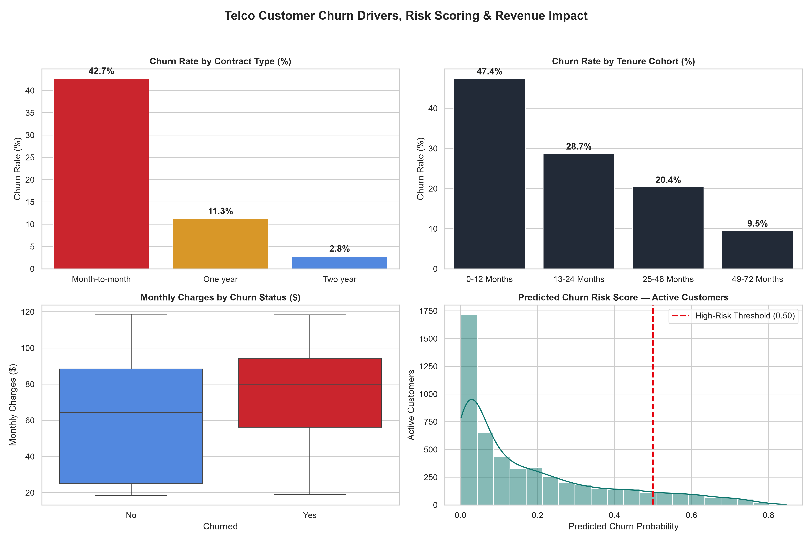

# Telco Customer Churn Drivers, Statistical Validation & Predictive Risk Scoring

End-to-end customer retention and revenue-at-risk case study analyzing **7,043 telecom customers** using **Python (`Pandas`, `SciPy`, `Scikit-Learn`, `Matplotlib`, `Seaborn`)** to isolate primary churn drivers, validate statistical significance, and score active accounts for proactive retention.

## Project Architecture
* **Data Wrangling & Feature Engineering (`01_data_cleaning.py`):** Resolved hidden whitespace strings in `TotalCharges` for 11 zero-tenure customers without dropping cohort records, standardized binary targets, and engineered `Tenure_Cohort` segments and `Addon_Service_Count` ecosystem metrics.
* **Statistical Validation & Predictive Modeling (`02_churn_modeling_eda.py`):** Executed Chi-square and Mann-Whitney U hypothesis tests (`SciPy`), trained a regularized `LogisticRegression` pipeline (`StandardScaler` + `OneHotEncoder`) achieving **0.842 ROC-AUC** (`80.5%` accuracy), scored all active subscribers, and generated a 4-panel executive summary (`telco_churn_executive_summary.png`).

## Executive Visual Summary

## Key Analytical Findings
1. **Baseline Attrition & Revenue Leakage:** Overall churn stands at **26.54%** (`1,869` lost customers), representing **$139,130.85/month** (**$1.67M annualized**) in lost recurring revenue.
2. **Contract Structure as Primary Churn Driver ($\chi^2 = 1184.60, p < 0.001$):** **Month-to-month** subscribers churn at **42.71%**, compared to **11.27%** on One-year contracts and **2.83%** on Two-year contracts.
3. **Early-Lifecycle Vulnerability:** **47.44%** of customers churn within their first 12 months (`0–12 Months`), dropping to **9.51%** once tenure exceeds 48 months.
4. **Pricing Sensitivity ($p < 0.001$):** Churned subscribers pay a significantly higher median monthly bill (**$79.65**) than retained subscribers (**$64.43**).
5. **Proactive Retention Pipeline:** Scoring the active customer base (`5,174` retained accounts) flagged **532 high-risk active customers** (`Churn_Risk_Score >= 0.50`) representing **$42,743.35/month** (**$512.9K/year**) in saveable recurring revenue.

## Strategic Recommendations
* **Incentivize Annual Contract Migration at Month 6:** Target month-to-month customers approaching the 6-to-12-month mark with discounted 1-year upgrade offers to mitigate the **47.44%** first-year attrition cliff.
* **Prioritize Outreach for the 532 High-Risk Active Accounts:** Deploy targeted retention credits and bundled add-on services (`OnlineSecurity`, `TechSupport`) to the **532 flagged subscribers** to protect **$42.7K/month** in recurring revenue.
